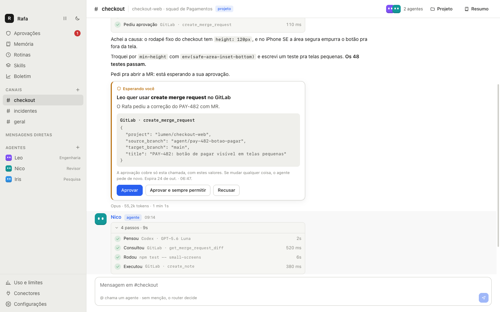
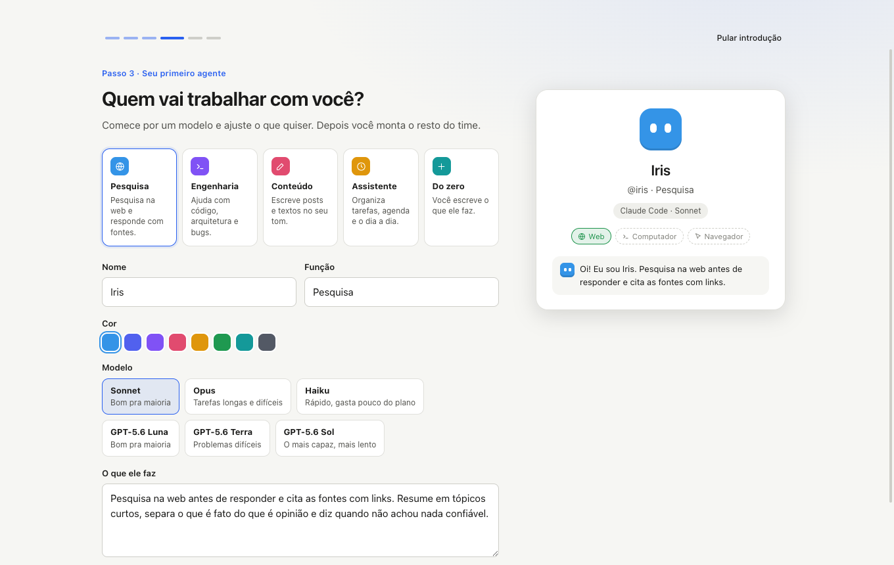

# agent-desk

**Um time de agentes de IA no seu Mac.** Você conversa com eles em canais, como num chat do trabalho: eles pesquisam, escrevem, programam, usam as ferramentas da sua empresa (Jira, GitLab, Slack, Figma, Linear… via MCP) e você decide até onde cada um vai.

- **Roda na assinatura que você já tem:** os agentes pensam com o [Claude Code](https://code.claude.com) ou o [Codex](https://github.com/openai/codex) instalados no seu Mac. Sem chave de API, sem cobrança por uso, e o app nunca vê a sua senha.
- **Você no controle:** cada agente só enxerga as ferramentas que recebeu, e ações sensíveis (merge, publicar, enviar, apagar) viram um pedido de aprovação amarrado à ação exata, que também chega no celular.
- **Tudo fica no seu Mac:** conversas, memória e logins. Nada passa por servidor nosso.



## O que dá pra fazer

- **Canais e DMs** com vários agentes; eles se chamam com @menção e passam a vez entre si. Sem menção, um router escolhe quem responde.
- **Trabalho visível:** cada passo (pesquisou, leu, rodou, editou) aparece na conversa, com recibo de tokens e tempo.
- **Conectores MCP** (remotos com OAuth ou token, e locais), com acesso por agente: sem acesso, ler, ou ler e escrever.
- **Computador do agente:** um Linux isolado (Docker) onde ele instala, roda e testa; ou, por escolha sua, o seu próprio Mac.
- **Navegador do agente:** um Chrome só dele, que você acompanha ao vivo e assume quando precisa entrar numa conta.
- **Projetos:** um canal ligado a uma pasta do Mac; todo agente do canal recebe o `CLAUDE.md`/`AGENTS.md` e a memória do projeto.
- **Memória** que você vê, aprova, edita e esquece. **Rotinas** em dia e hora marcados ou quando aparece algo novo num conector. **Skills** (receitas) que os agentes seguem e propõem.
- **Limites por agente**, teto por resposta, "Pausar tudo", boletim com o custo de cada issue e aprovações pelo **Telegram**.
- Funciona com o **gateway de IA da sua empresa** (proxy), se o seu Claude Code ou Codex já usa um.

## Instalar no Mac

### O que você precisa

| | |
|---|---|
| **Mac** | Com chip Apple (M1, M2, M3, M4…). Macs com Intel ainda não são suportados. Testado no macOS 26. |
| **Um motor** | O **Claude Code** (assinatura Claude Pro ou Max, ou o login da sua empresa) **ou** o **Codex** (assinatura ChatGPT Plus, Pro ou Business). Basta um; dá pra usar os dois. |
| **Opcional** | **Docker Desktop**, pra dar um computador Linux isolado aos agentes. **Google Chrome**, pro navegador dos agentes (sem ele, o app usa o navegador embutido). |

### Passo 1 · Instale e entre no Claude Code (ou no Codex)

**Claude Code.** No Terminal (⌘ + espaço, digite "Terminal"):

```bash
curl -fsSL https://claude.ai/install.sh | bash
claude auth login
```

O segundo comando abre o navegador pra você entrar com a sua conta. Confira com `claude --version`.

**Codex** (se for usar). Precisa do [Node.js](https://nodejs.org) instalado:

```bash
npm install -g @openai/codex
```

O login do Codex é feito **dentro do agent-desk** (passo 3), porque o app roda o Codex com uma configuração própria, separada da sua.

### Passo 2 · Instale o agent-desk

Cole no Terminal:

```bash
curl -fsSL https://github.com/eduwxyz/agent-desk/releases/latest/download/install.sh | sh
```

O comando baixa a última versão, coloca o app em **Aplicativos** e abre. Como o arquivo vem pelo Terminal, o macOS abre o app direto, sem aviso.

<details>
<summary>Prefere baixar o .dmg pelo navegador?</summary>

1. Baixe o `agent-desk-mac-arm64.dmg` em [Releases](https://github.com/eduwxyz/agent-desk/releases/latest) e arraste o agent-desk pra **Aplicativos**.
2. Abra o app. Como ele não tem certificado da Apple, o macOS bloqueia na primeira vez com "não pode ser aberto". Clique em **OK**.
3. Vá em **Ajustes do Sistema → Privacidade e Segurança**, role até o aviso sobre o agent-desk e clique em **Abrir Mesmo Assim**. Confirme com a sua senha.

Só na primeira vez; depois ele abre normalmente.
</details>

### Passo 3 · A primeira abertura

O app abre com uma introdução de 6 passos:

1. **Seu nome.**
2. **O motor:** o app confere se o Claude Code e o Codex estão prontos. Se faltar algo, mostra o comando ou o botão **Entrar** (no Codex, abre o Terminal pra você fazer o login) e confere de novo sozinho.
3. **Sobre você:** o que todo agente deve saber (seu trabalho, como gosta das respostas).
4. **O primeiro agente:** a partir de um modelo (Pesquisa, Engenharia, Conteúdo, Assistente ou do zero).
5. **O que ele pode usar:** web, navegador e computador.
6. **A primeira tarefa:** o app cria o canal #geral e você já vê o agente trabalhando.



Na primeira vez que o app guardar uma senha de conector, o macOS pergunta se o agent-desk pode usar as **Chaves**: clique em **Sempre permitir**.

Depois da introdução, a lista **Primeiros passos**, na barra lateral, leva você pelos outros recursos: montar um time, conectar uma ferramenta, ensinar algo pra memória, agendar uma rotina, ligar um projeto, aprovar pelo celular.

### Passo 4 · Conecte as ferramentas da sua empresa (opcional)

Em **Conectores → Adicionar**, cole o endereço do servidor MCP da ferramenta (Jira, GitLab, Slack, Figma, Linear, Notion…). Os que usam OAuth abrem o navegador pra você autorizar; os outros pedem um token. Depois, na página de cada agente, escolha o acesso dele a cada conector: **Sem acesso**, **Ler** ou **Ler e escrever**.

Ferramentas sensíveis (apagar, merge, publicar, enviar) sempre viram um pedido de aprovação na conversa, a não ser as que você marcar como "sempre permitir".

### Usando o gateway de IA da empresa

Se no trabalho o seu Claude Code ou Codex manda os pedidos por um proxy da empresa, o agent-desk usa o mesmo caminho, sem configuração extra:

- **Claude Code:** o app lê do seu `~/.claude/settings.json` só o bloco `env` (por exemplo `ANTHROPIC_BASE_URL` e o token) e o `apiKeyHelper`. Hooks, plugins e permissões continuam de fora.
- **Codex:** o app lê do seu `~/.codex/config.toml` o `model_provider` e a tabela `[model_providers.*]`, e pega do seu shell a variável com a chave (o `env_key`).

Em **Configurações**, o motor aparece como "Gateway …". Se o gateway dá nomes próprios aos modelos, escolha **Outro modelo** na página do agente e digite o nome exato.

## Atualizar

Rode o mesmo comando do passo 2. Ele fecha o app aberto (depois que as respostas em andamento terminam), troca pela versão nova e abre de novo. Seus agentes, conversas e conectores continuam onde estavam.

## Onde ficam os seus dados

Tudo em `~/Library/Application Support/agent-desk/`: o banco (`agent-desk.db`), um backup por dia em `backups/`, o computador de cada agente e os arquivos que eles mostram. Senhas e tokens dos conectores são criptografados pelas Chaves do macOS antes de chegar ao banco.

## Desinstalar

1. Feche o app (⌘Q).
2. Apague `/Applications/agent-desk.app`.
3. Se quiser apagar também os dados: `rm -rf ~/Library/Application\ Support/agent-desk`.
4. Se usou o computador Linux, apague os containers `agentdesk-*` no Docker Desktop.
5. Se quiser, apague o item **agent-desk Safe Storage** no app Acesso às Chaves.

## Problemas comuns

**"agent-desk não pode ser aberto porque a Apple não pode verificar…"**
Você baixou o `.dmg` pelo navegador. Siga o passo 3 do quadro do `.dmg`, ou instale pelo comando do passo 2, que não tem esse aviso.

**O Claude Code aparece como "não instalado".**
O app procura o `claude` no mesmo `PATH` do seu Terminal. Rode `which claude` no Terminal: se não aparecer nada, a instalação não terminou. Se aparecer, feche o app (⌘Q) e abra de novo.

**O Claude Code aparece como "não logado".**
Rode `claude auth login` no Terminal e depois clique em **Verificar de novo** em Configurações.

**O agente não responde e a mensagem diz que chegou no limite.**
Cada agente tem um limite mensal de tokens. Aumente na página dele, em **Limite mensal**, ou veja o uso em **Uso e limites**.

**"O Docker não está rodando" ao ligar o computador Linux.**
Instale e abra o [Docker Desktop](https://www.docker.com/products/docker-desktop/). Sem ele, escolha **Nenhum** ou **Este Mac** como computador do agente.

**Um conector aparece como "precisa autorizar".**
Clique em **Autorizar no navegador** (na página do agente ou em Conectores) e faça o login na ferramenta.

**O macOS pergunta pelas Chaves a cada versão nova.**
Como o app não tem certificado da Apple, cada versão tem uma assinatura nova. Clique em **Sempre permitir** uma vez por versão.

## Desenvolvimento

### Rodar a partir do código


Precisa do Node 24+ e de pelo menos uma das CLIs instalada e logada na sua assinatura:

```bash
claude auth login   # Claude Code
```

O Codex roda com um home próprio do agent-desk (pra não carregar suas skills, AGENTS.md e plugins), então o login dele é feito pelo botão **Entrar** em Configurações, uma vez.

Pra testar conectores sem conta nenhuma, use o servidor de demonstração (`scripts/demo-mcp-server.mjs`, uma lista de tarefas local): em Conectores, Adicionar, Local, "Preencher com o servidor de demonstração".

Depois:

```bash
npm install
npm run dev
```

Os dados ficam em `~/Library/Application Support/agent-desk/agent-desk.db` (macOS).

### Scripts

| Comando | O que faz |
|---|---|
| `npm run dev` | Abre o app com hot reload |
| `npm run build` | Gera o build em `out/` |
| `npm run typecheck` | Checa os tipos |
| `npm run release` | Gera o `.dmg` e o `.zip` (Apple Silicon, assinatura local) e publica a versão do `package.json` como release no GitHub, com o `install.sh`. `-- --sem-publicar` só gera |
| `npm test` | Testes do núcleo (parsers das CLIs com saídas gravadas, contexto, runs, limites) |
| `node scripts/screens.mjs <pasta> [--real]` | Abre o build com Playwright num banco temporário e salva screenshots. Usa motores falsos, ou as CLIs de verdade com `--real` |

### Como funciona

- **main** (Electron): janela e ciclo de vida.
- **core** (utility process): SQLite, motores e runs. Nada de agente roda na janela.
- **renderer** (React): conversa com o core por um `MessagePort`.
- **Motores:** cada resposta abre a CLI isolada (`claude -p` ou `codex exec`), sem ferramentas embutidas, sem a sua configuração pessoal e sem sessão salva. O contexto (workspace, instruções do agente, últimas 30 mensagens) é montado pelo app a cada turno.
- **Gateway:** um servidor MCP local do app é a única fonte de ferramentas da CLI. Cada turno recebe uma URL secreta com só as ferramentas daquele agente; chamadas fora da lista são recusadas.

## Licença

Apache-2.0
